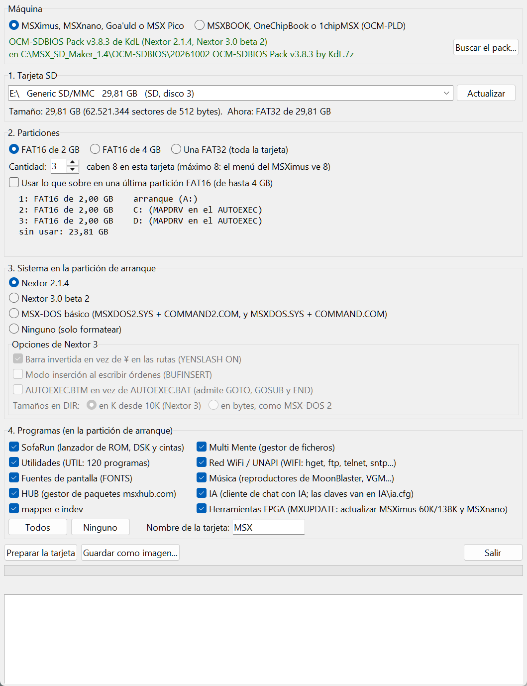
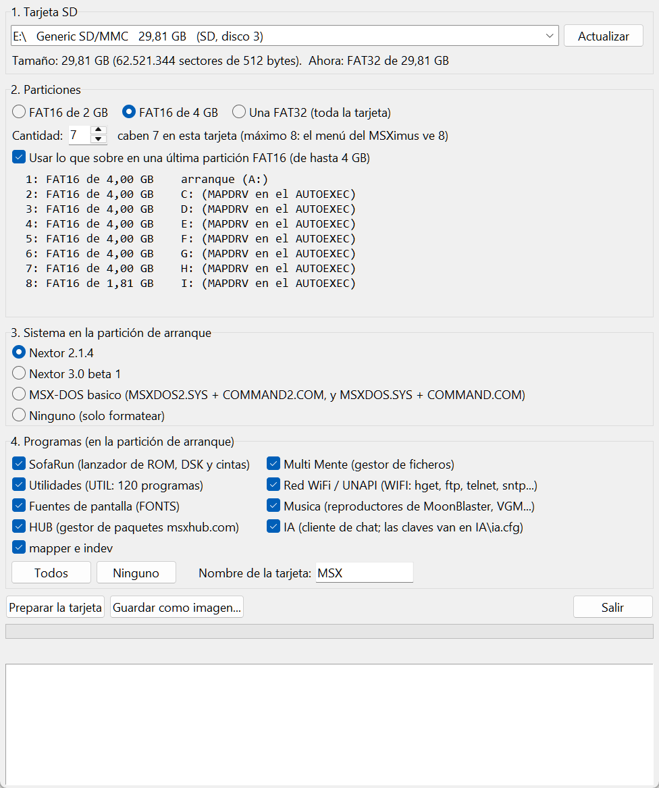
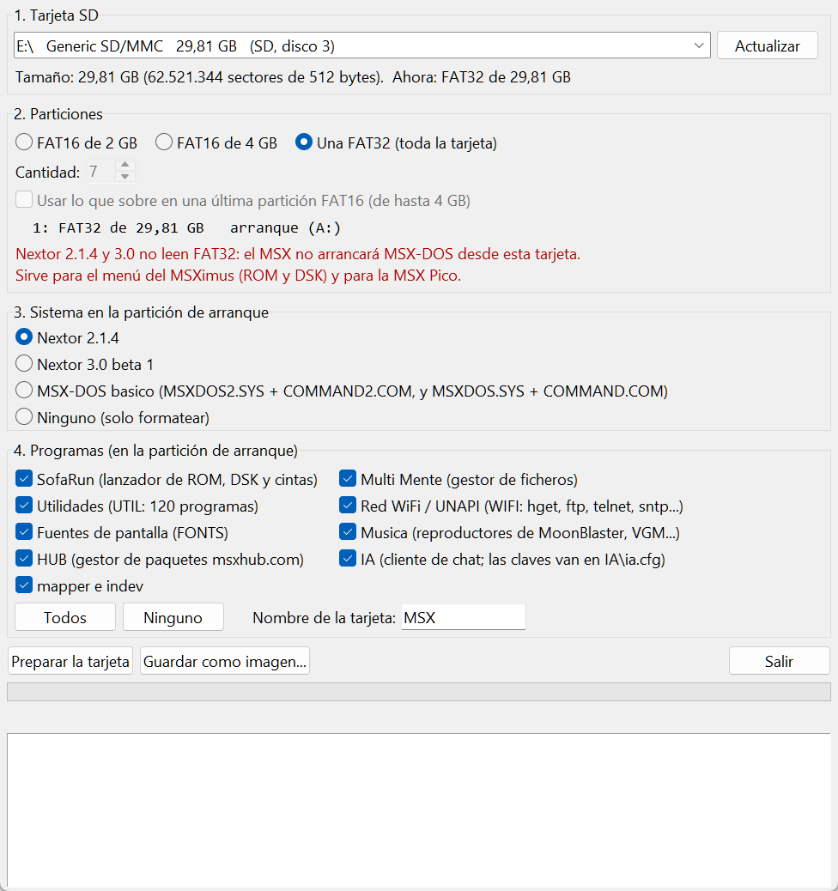
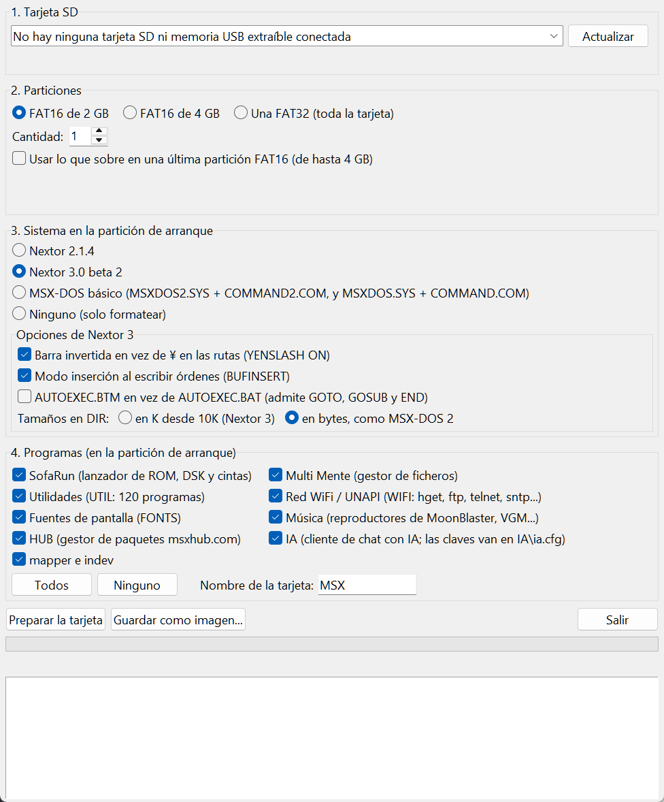
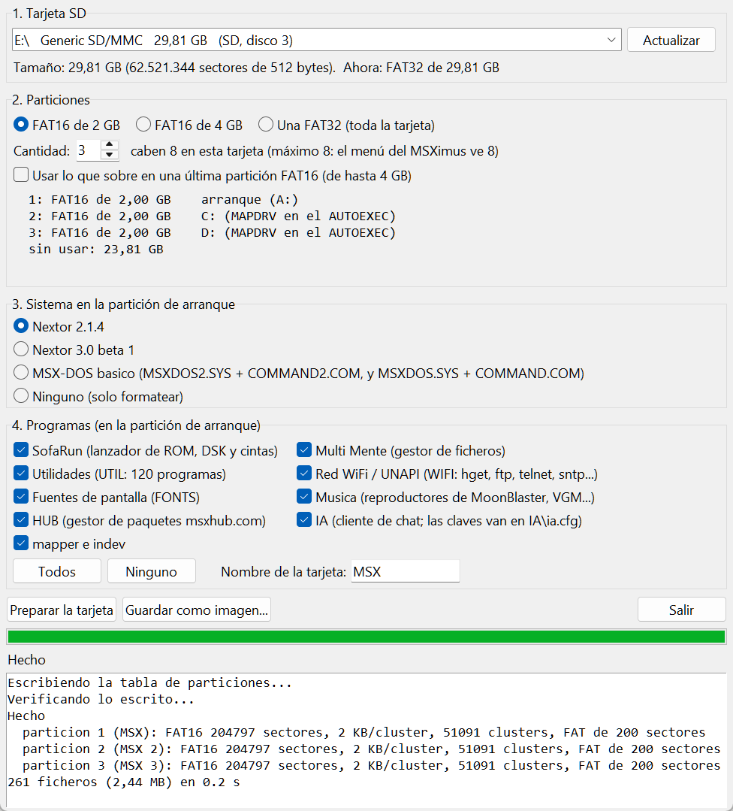
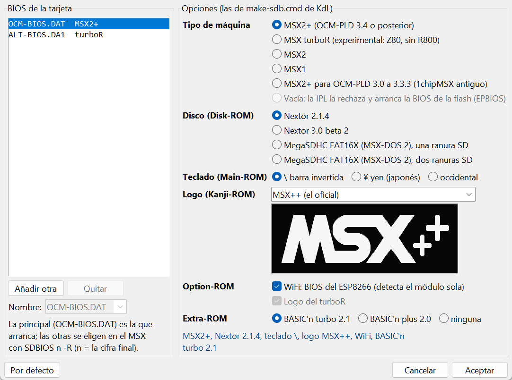

# MSX SD Maker 1.8.1 — preparing the SD card

*[Versión en castellano](LEEME.md)*

**MSX SD Maker** gets an SD card ready for an **MSXimus** (Tang Console 60K, Tang Mega 138K or the Zynq version), an **MSXnano** or an **MSX Pico**, and also for an **MSXBOOK**, **OneChipBook** or **1chipMSX** (see [section 11](#11-msxbook-onechipbook-and-1chipmsx)). In a few seconds it does all this:

1. Wipes the card and splits it into partitions that MSX-DOS understands.
2. Formats each partition.
3. Copies the operating system (Nextor or MSX-DOS) to the first partition.
4. Copies a set of programs: SofaRun, Multi Mente, utilities, networking, music…
5. Writes an `AUTOEXEC.BAT` that sets everything up at boot.
6. Reads everything back to check that the card came out right.

And **Update card…** brings a card you already made up to date (system and programs) without formatting and without deleting or overwriting anything of yours: see [section 12](#12-updating-an-existing-card).

Nothing to install: on Windows it is `MSXsdmaker.exe`; on macOS, `MSXsdmaker.app`. The program speaks Spanish and English.

Version 1.7.4 speaks Spanish and English: at the top right, **Idioma / Language** switches the language at
once without losing your choices, and remembers it for next time (the first time, the system's). Version 1.7.3 replaced Multi Mente with **2.07A+ RC5** (with the FAT16 and year 2000 fixes) with long file names:
12 characters in the list and up to 31 in the one-column view (SHIFT+1). Version 1.7.2 added the visual editor for
MSXnano/MSXimus BIOS packs and the final Nextor 3 tools in `UTILS`.

---

## Contents

1. [What you need](#1-what-you-need)
2. [Opening the program](#2-opening-the-program)
3. [Step by step](#3-step-by-step)
4. [What ends up on the card](#4-what-ends-up-on-the-card)
5. [First boot on the MSX](#5-first-boot-on-the-msx)
6. [Adding games and programs](#6-adding-games-and-programs)
7. [Saving an image instead of a card](#7-saving-an-image-instead-of-a-card)
8. [Troubleshooting](#8-troubleshooting)
9. [For the curious: how it works](#9-for-the-curious-how-it-works)
10. [Licenses and credits](#10-licenses-and-credits)
11. [MSXBOOK, OneChipBook and 1chipMSX](#11-msxbook-onechipbook-and-1chipmsx)
12. [Updating an existing card](#12-updating-an-existing-card)

---

## 1. What you need

- **A PC with Windows 10/11 or a Mac running macOS 13 or later.**
- **A card reader**: the laptop's own or a USB one.
- **An SD or microSD card of 4 GB or more.** 8 to 32 GB is the most practical. Bigger cards work too, but with FAT16 only 8 partitions are used.
- **To know which Nextor version your machine runs.** It depends on the BIOS pack or the `BOOT` file you flashed. See [step 3.3](#33-the-system).

> ⚠️ **The program wipes the whole card.** If it holds anything you want to keep, copy it to the PC first.

---

## 2. Opening the program

1. Download the ZIP for your system from the [latest MSX SD Maker release](https://github.com/Papipapito/SD_Maker/releases/latest) and **unzip it** anywhere. It contains `MSXsdmaker.exe` or `MSXsdmaker.app`, this guide, and the `sd` folder with everything copied to the card (systems and programs). If you change or add a file in one of its folders, yours is copied; if you delete it, the program uses its bundled copy.
2. Put the card in the reader.
3. Open `MSXsdmaker.exe` on Windows or `MSXsdmaker.app` on macOS.
4. On Windows, accept the permission prompt. On macOS, the app asks only after you click **Prepare the card**. This is necessary because it writes the whole card, partition table included.

**New versions**: when it opens, the program checks GitHub for a newer MSX SD Maker; if there is one, it says so and offers to open the download page. Without internet nothing happens.

**If Windows shows "Windows protected your PC"** (SmartScreen): click **More info** and then **Run anyway**. It appears because the program is not digitally signed.

**If macOS blocks the app the first time**: Control-click `MSXsdmaker.app`, choose **Open**, and confirm. The app is locally signed but not notarized by Apple.

**If your antivirus complains**: Python programs packed into a single `.exe` sometimes trigger false positives. The source code is in [SD_Maker](https://github.com/Papipapito/SD_Maker) (and a copy in the `fuente/` folder).

---

## 3. Step by step



At the top, in **Máquina** (*Machine*), leave the first option ticked (MSXimus, MSXnano, Goa'uld or MSX Pico); for the MSXBOOK, OneChipBook or 1chipMSX see [section 11](#11-msxbook-onechipbook-and-1chipmsx). Below there are four blocks, top to bottom. Fill them in order and press **Preparar la tarjeta** (*Prepare the card*).

### 3.1 The card — *1. Tarjeta SD*

The list at the top shows the connected cards: drive letter, reader name, size and type. If you have just inserted the card and it is not there, press **Actualizar** (*Refresh*).

Below it you see the exact size and what is on the card now (*Ahora*), for example "FAT32 de 29,81 GB".

> 🛡️ **Only SD card readers and removable USB sticks are listed.** The Windows or macOS system disk never appears, and neither do external hard disks. Still, check the size carefully before going on.

### 3.2 The partitions — *2. Particiones*

A **partition** is a slice of the card that the MSX sees as a separate drive (A:, C:, D:…). MSX-DOS cannot handle huge disks, so the card is split into slices it does understand.

| Option | Size of each partition | What it is for |
|---|---|---|
| **FAT16 de 2 GB** | 2 GB | **The recommended choice.** Every file takes at least 32 KB, so little is wasted on small ROM and DSK files. |
| **FAT16 de 4 GB** | 4 GB, the Nextor maximum | Fewer, bigger partitions. Every file takes at least 64 KB. |
| **Una FAT32** | The whole card | Only for the MSXimus menu (ROM and DSK) and the MSX Pico. **MSX-DOS cannot see it** (see the warning below). |

**Cantidad** (*count*). The program tells you how many partitions fit on your card and does not let you go beyond that. The maximum is 8, the number the MSXimus menu walks through.

**"Usar lo que sobre en una última partición FAT16"** (*use the leftover space in one last FAT16 partition*). Tick it so the end of the card is not wasted: one more, smaller partition is created with what is left (up to 4 GB). If you leave it unticked, that space stays unused and neither Windows nor the MSX sees it.

Below you see how the card will end up. For example (*arranque* = boot, *sin usar* = unused):

```
  1: FAT16 de 2,00 GB    arranque (A:)
  2: FAT16 de 2,00 GB    C: (MAPDRV en el AUTOEXEC)
  3: FAT16 de 2,00 GB    D: (MAPDRV en el AUTOEXEC)
  sin usar: 23,81 GB
```

How many fit on the most common cards (their real capacity is a bit less than the label says):

| Card | FAT16 2 GB | + leftover | FAT16 4 GB | + leftover |
|---|---|---|---|---|
| 2 GB | 1 with the whole card | — | 1 with the whole card | — |
| 4 GB | 1 | + 1 of 1.7 GB | 1 with the whole card | — |
| 8 GB | 3 | + 1 of 1.4 GB | 1 | + 1 of 3.4 GB |
| 16 GB | 7 | + 1 of 0.8 GB | 3 | + 1 of 2.8 GB |
| 32 GB | 8 | — | 7 | + 1 of 1.7 GB |
| 64 GB or more | 8 | — | 8 | — |



> ⚠️ **FAT32 and MSX-DOS.** Neither Nextor 2.1.4 nor Nextor 3.0 can read FAT32 partitions. With a FAT32 card the MSX **will not boot MSX-DOS** from it; you get the MSXimus menu or BASIC. On the MSXimus, the menu also cannot download from File-Hunter or save cartridge SRAM on FAT32: it only launches ROM and DSK files. Choose it only for that, or for the MSX Pico.
>
> 

### 3.3 The system — *3. Sistema en la partición de arranque*

This is the operating system copied to the first, boot partition. **It must match the Nextor your machine runs**; otherwise the MSX never reaches MSX-DOS.

| Your machine | If you flashed… | Choose |
|---|---|---|
| MSXimus 60K or 138K | `pack_bios_msximus.bin` or `pack_bios_msximus_en.bin` | **Nextor 2.1.4** |
| MSXimus 60K or 138K | `pack_bios_msximus_nextor3.bin` or `…_en_nextor3.bin` | **Nextor 3.0 beta 2** |
| MSXimus Z (Zynq) | a `BOOT_…_nextor214.bin` | **Nextor 2.1.4** |
| MSXimus Z (Zynq) | a `BOOT_…_nextor3.bin` | **Nextor 3.0 beta 2** |
| MSXnano | `pack_bios_msxnano.bin` or `pack_bios_msxnano_en.bin` | **Nextor 2.1.4** |
| MSXnano | `pack_bios_msxnano_nextor3.bin` or `…_en_nextor3.bin` from release v2.1.1 | **Nextor 3.0 final** |
| MSXnano | those packs from a release before v2.1.1 | **Nextor 3.0 beta 2** |
| Goa'uld | `pack_bios_goauld_es.bin` or `pack_bios_goauld_en.bin` | **Nextor 2.1.4** |
| MSX Pico or another MSX with Nextor 2.1 | — | **Nextor 2.1.4** |

The MSXimus and Zynq `…nextor3.bin` packs, and the MSXnano ones from before v2.1.1, contain beta 2, so they must keep using the beta 2 option. To move one to
the final release, click **Crear o personalizar pack BIOS…**, then **Sólo actualizar Nextor…**. The app replaces only the 128 KB Nextor
block and preserves the remaining BIOS ROMs, the SD-reader driver and the six configuration bytes. Flash the output
file and then choose **Nextor 3.0 final** when preparing the card. Keep a backup of the original pack.

The advanced part of the same window builds a final Nextor 3.0 ROM from the included base kernel and a
hardware-specific Nextor 3 driver. It optionally accepts mapper code, extra data, an 8 KB mapper and a boot-key
inverter, like `mknexrom` 1.2. A Nextor 2 driver cannot be used with Nextor 3.

**Personalizar bloques…** also opens the complete 512 KB pack map. JIS1/JIS2, main BIOS, SubROM, network and logo
can be replaced from a local file or through File-Hunter, with exact-size validation. Essential menu blocks are
protected; MSX-MUSIC shares its block with the first menu page and the app warns before replacing it. The reserved
16 KB area is not connected as a slot and cannot hold a utility. A six-byte configuration tail is preserved.

With **final Nextor 3.0**, its 26 matching tools are always copied to `\UTILS` and added to `PATH`, even when the
general Utilities group is disabled. This keeps `EMUFILE`, `MAPDRV`, `DRVINFO` and the other tools matched to it.

The other two options:

- **MSX-DOS básico** (*basic MSX-DOS*): only `MSXDOS2.SYS` and `COMMAND2.COM`, plus MSX-DOS 1's `MSXDOS.SYS` and `COMMAND.COM`, without the Nextor tools. Without them the `AUTOEXEC` cannot mount C:, D:…; do it by hand with `CALL MAPDRV` from BASIC.
- **Ninguno (solo formatear)** (*none, format only*): partitions and formats, with no system and no programs. Handy for a games-only card.

If the card is smaller than a whole partition ("2 GB" cards hold a little under 2 GB), a single partition with the whole card is made.

**Nextor 3 options** (*Opciones de Nextor 3*). With Nextor 3 a box with four boot options is enabled:

| Option | What it does | Default |
|---|---|---|
| Backslash instead of ¥ (`YENSLASH ON`) | Paths show as `A:\DIR\FILE` instead of with the yen sign of Japanese MSX computers. Since beta 2, `YENSLASH` is a command of `COMMAND3.COM` itself | Ticked |
| Insert mode (`SET BUFINSERT=ON`) | What you type at the prompt is inserted instead of overwriting. INS toggles, as always | Not ticked |
| `AUTOEXEC.BTM` instead of `AUTOEXEC.BAT` | `COMMAND3.COM` loads it whole, so it accepts `GOTO`, `GOSUB`, `RETURN` and `END` | Not ticked |
| Sizes in DIR | In K from 10K (Nextor 3's way) or always in bytes, like MSX-DOS 2 (`SET DIRK=0`). `DIRB` always shows bytes | In K |



> ℹ️ MSX-DOS 1 only boots from FAT12 partitions of 16 MB or less, which is not what this program creates. That is why any of these options boots MSX-DOS 2; the MSX-DOS 1 files are there only in case you need them.

### 3.4 The programs — *4. Programas*

They are copied to the first partition, each in its own folder. Tick the ones you want; **Todos** (*all*) and **Ninguno** (*none*) help.

| Checkbox | Folder | What it is | How to start it |
|---|---|---|---|
| SofaRun | `SOFARUN` | ROM, DSK and CAS tape launcher with a menu, by Louthrax | `SR` |
| Multi Mente | `MM` | Two-pane file manager. RETURN opens each file with its program: VGM and VGZ, ROM, DSK, ZIP, MWM and MFM (MoonBlaster Wave and FM), MID, PC AdLib music (RAD, DRO, SOP…), MOD, PT3, pictures…; files with no program open in the viewer | `MM` |
| Utilidades | `UTIL` | About 120 tools: `DI` (DIR with long names), `LOGIN`, players, copying… | by name |
| Red WiFi / UNAPI | `WIFI` | TCP/IP networking: `HGET`, `FTP`, `TELNET`, `SNTP`, `FH` (File-Hunter)… | by name |
| Fuentes de pantalla | `FONTS` | Fonts for Multi Mente (ISO Latin-1, Japanese, Russian…) | used by MM |
| Música | `musica` | The MoonBlaster Wave 1.17 (`mbwave\`) and MoonBlaster FM 1.03A (`mbfm\`) editors, both for the OPL4/MoonSound and needing more than 128 KB of memory; RoboPlay 2.1 (`roboplay\`, by ToriHino), which plays MoonBlaster FM and Wave songs on the OPL4 (it loads the wavekit by itself) and many more formats (MBM, MID, RAD, DRO, PRO, SBM…); `MUSPLAY` (ours), which plays a `.MUS` with the right player: an MGS one (text) with MGSC and a FAC SoundTracker one (binary) with RoboPlay; and the MWM and VGM players | `ROBOPLAY song`, `MUSPLAY song.MUS`, `MWMPLAY`, `VGMPLAY`; the editors by their path: `\musica\mbwave\mbwave`, `\musica\mbfm\mbfm` |
| HUB | `hub` | MSX Hub client, to install programs from the internet | `HUBG` or `HUB` |
| IA | `IA` | AI chat client; your keys go in `IA\ia.cfg` | `IA` |
| mapper e indev | `mapper`, `indev.com` | `MAPPER` disables the MSX-DOS 2 mapper routines for old software | by name |
| Herramientas FPGA | `FPGA` | `MXUPDATE`: updates the core and the pack of the MSXimus 60K/138K and the MSXnano (2.1.1 or later) from MSX-DOS, from a `.UPD` on the card or over WiFi (`MXUPDATE /N`); over WiFi it first brings itself up to date. `MXUPDATE /?` shows the commands. On the 60K and the 138K, `MXUPDATE /O` downloads the OPL4 waves (YRW801) from msx.barcelona and writes them to the flash. The MSXimus Z (Zynq) updates itself. `MTVOL`: OPL4 FM and Wave volume (MSXimus and MoonTANG): `MTVOL FM 9`, `MTVOL WAVE 6`, `MTVOL FM M` (mute); the number goes from 0 to 18 in steps of 3 (18 = maximum, 0 dB; each step is 3 dB); with no arguments it shows the levels | `MXUPDATE`, `MTVOL` |

Whenever a system is installed these empty folders are created too. **Do not delete them**:

- `FHUNT`: where the MSXimus menu saves what it downloads from File-Hunter. The menu cannot create folders, so it must exist.
- `TMP`: temporary folder for MSX-DOS and SofaRun.
- `SAVES` and `SETTINGS`, if you ticked SofaRun: its saved games and its settings.

**Nombre de la tarjeta** (*card name*): the name of partition 1 as shown in Windows or Finder and by `VOL` in MSX-DOS. The others get the same name with their number: "MSX 2", "MSX 3"…

### 3.5 Preparing

1. Press **Preparar la tarjeta**.
2. The program shows **what it is going to wipe** (the card's name, size and drives) and **what it will create**. Read it carefully. It only goes ahead if you answer **Sí** (*Yes*); the default button is No.
3. The bar moves while it works. It takes a few seconds; somewhat longer with FAT32 on big cards.
4. At the end it **verifies**: it reads back the partition table and every copied file and compares them with what it meant to write. If everything matches it says **"La tarjeta está lista y verificada"** (*the card is ready and verified*).
5. The system mounts the card again. Each partition gets a drive letter on Windows or appears as a volume in Finder on macOS.



You can take the card out now. Use "Eject" in Windows or Finder first, as with any memory stick.

---

## 4. What ends up on the card

**Partition 1** (A: on the MSX), with Nextor 2.1.4 and every program:

```
A:\
├── NEXTOR.SYS, COMMAND2.COM       the system (with Nextor 3: COMMAND3.COM)
├── MSXDOS2.SYS, MSXDOS.SYS…       fallback system files
├── AUTOEXEC.BAT                   runs at boot (see below)
├── bin\                           Nextor tools: MAPDRV, DRIVERS, DEVINFO…
├── SOFARUN\  SAVES\  SETTINGS\    SofaRun and its folders
├── MM\  FONTS\                    Multi Mente and its fonts
├── UTIL\  WIFI\  musica\          utilities, networking and music
├── hub\  IA\  mapper\  indev.com
├── FPGA\                          MXUPDATE: updating the MSXimus and MSXnano core; MTVOL: OPL4 volume
├── FHUNT\                         File-Hunter downloads (do not delete)
└── TMP\                           temporary (do not delete)
```

**Partitions 2, 3…** are left empty for your games and programs.

### The AUTOEXEC.BAT

It is generated from your choices. With everything ticked and three partitions it looks like this:

```
PATH A:\;%1\BIN;%1\musica;%1\musica\roboplay;%1\SOFARUN;%1\MM;%1\UTIL;%1\WIFI;%1\hub;%1\IA;%1\mapper;%1\FPGA
SET TIMEZONE=+02:00
mode 80
ALIAS .BAS = "BASIC "
ALIAS .ASC = "BASIC "
sntp pool.ntp.org /v
set temp %1\TMP
set MM=%1\MM
set MGSDRV=%1\UTIL\MGSDRV.COM
alias .ROM srom
alias .DSK sri
yenslash
SET FONT0808=%1\FONTS\ISO-LAT1.FNT
echo Type LOGIN to show system info (not for MSX1!)
echo Type DI for DIR with long filenames
echo Type SR to start Sofarun
echo Type MM to start Multi Mente
echo Type HUBG to start HUB Gui or HUB to CLI
echo Type FH to FileHunter Download
echo
echo Maped Units C,D
mapdrv c: 2 1 0
mapdrv d: 3 1 0
```

What each part does:

- **`PATH`**: you can type any program's name from any folder, without its path. `%1` is the boot drive. `musica` comes before `SOFARUN` because both hold a `VGMPLAY` and the good one is in `musica` (SofaRun runs its own by its path). `musica\roboplay` is there so that you can type plain `ROBOPLAY`: RoboPlay looks for its players (`.PLY`) next to `ROBOPLAY.COM`.
- **`set MM`** and **`set MGSDRV`**: where Multi Mente and the MGSDRV driver are; MGSC, the player of MGS `.MUS` songs, loads it from there.
- **`SET TIMEZONE`**: the time zone (+02:00, Central European summer time). Change it if needed.
- **`mode 80`**: 80-column screen.
- **`ALIAS`**: typing the name of a `.BAS` opens it in BASIC; the name of a `.ROM` or `.DSK` launches it with SofaRun.
- **`sntp`**: sets the clock from the internet if there is a network. Without one it prints an error and carries on: that is normal.
- **`mapdrv c: 2 1 0`**: mounts partition 2 as drive C:, partition 3 as D:, and so on up to partition 7 on H:. MSX-DOS only has drives A: to H:, so with 8 partitions partition 8 goes on **B:** (`Maped Units C,D,E,F,G,H,B`). On the MSXimus and the MSXnano B: is free. On an MSX with a floppy drive, B: stops being the floppy drive until you reboot or type `mapdrv b: d`.

With **Nextor 3**, instead of `yenslash` come the lines of its options (`YENSLASH ON`, plus `SET BUFINSERT=ON` and `SET DIRK=0` if ticked), and the file is `AUTOEXEC.BTM` if you choose that option.

You can edit `AUTOEXEC.BAT` from Windows with Notepad. Keep its name.

---

## 5. First boot on the MSX

1. Put the card in the machine and switch it on.
2. **MSXimus and MSXnano**: if "Menú al arrancar" (*menu at boot*) is on in the Settings, the card browser appears.
   - The bottom line shows which partition you are in, for example `P1/3`. **TAB** moves to the next one.
   - **R**, **D** and **A** filter by ROM, DSK or all.
   - **ESC** leaves the menu and boots MSX-DOS from the card.
3. MSX-DOS boots, runs `AUTOEXEC.BAT` and stops at `A:\>`. Something like this (tested on an MSXimus Z with a three-partition card):

```
SNTP time setter for the TCP/IP UNAPI 1.1
*** ERROR: Unknown error when opening UDP connection (code 15)      <- no network: normal
Type LOGIN to show system info (not for MSX1!)
Type DI for DIR with long filenames
Type SR to start Sofarun
Type MM to start Multi Mente
Type HUBG to start HUB Gui or HUB to CLI
Type FH to FileHunter Download

Maped Units C,D
A:\>vol c:
 Volume in drive C: is MSX 2
A:\>vol d:
 Volume in drive D: is MSX 3
```

Useful commands to start with:

| Type | To |
|---|---|
| `SR` | SofaRun: pick and launch ROM, DSK and tapes |
| `MM` | Multi Mente: copy, move and delete files, and open them with RETURN |
| `DI` | List the folder with long names |
| `DIR C:` | See what is on partition 2 |
| `LOGIN` | System information |
| `BASIC` | Go to MSX-BASIC |

---

## 6. Adding games and programs

With the card in the PC, each partition is a Windows drive. Copy files by dragging them, as with any USB stick.

A convenient way to organise it:

| Partition | On the MSX | For |
|---|---|---|
| 1 | A: | System and programs (leave it as it is) |
| 2 | C: | Cartridge ROMs |
| 3 | D: | DSK disk images |
| 4 | E: | Music, pictures, anything |

Good to know:

- **Long names.** The MSXimus menu and Windows show them in full, like "Aleste 2 (1988).rom". MSX-DOS sees the 8+3 short name Windows generates, like `ALESTE~1.ROM`. SofaRun, on the 80-column screen, shows a one-column list with the long name (up to 63 characters) and the size; it launches with the 8.3 name, and in 40 columns the list stays 8.3. Multi Mente shows the first 12 characters of the long name in its file list (31 in the one-column view, SHIFT+1), and the whole name of the file under the cursor in its "File info" box (with Nextor 2.1 or 3.0).
- **The MSXimus menu** walks every partition with TAB and launches ROM and DSK files without going through MSX-DOS.
- **Do not format the partitions from Windows.** Windows would change their format or cluster size. To start over, run the card through MSX SD Maker again.
- **Do not delete `FHUNT` or `TMP`** from partition 1.

---

## 7. Saving an image instead of a card

**Guardar como imagen…** (*save as image*) creates an `.img` file with the whole card instead of writing it. Useful to:

- Prepare several identical cards: write the image with Rufus, balenaEtcher or Win32 Disk Imager.
- Try it in an emulator.
- Keep a copy of a setup.

The program asks for the image size. An image can be written to a card of that size **or larger**, never smaller, and cards hold a little less than their label says: `1800M` fits any 2 GB card and `3500M` any 4 GB card. The image only takes up on the PC's disk what was really written, not its whole size.

Every MSXimus release also ships a ready-made image with Nextor 3 (1800 MB, all programs): just write it.

---

## 8. Troubleshooting

**The card is not in the list.**
Check it is properly inserted and press **Actualizar**. Only SD readers and removable USB sticks are listed. Some USB-SATA or USB-NVMe adapters present themselves as fixed disks and are left out on purpose.

**"La unidad E: está en uso: cierra lo que la tenga abierta"** (*drive E: is in use: close whatever has it open*).
Close the Explorer windows showing the card and any program with files open on it. Try again.

**The program says it needs administrator rights.**
On Windows, open it by double-clicking and answer **Yes**. On macOS, enter an administrator password when the app requests it at the start of the operation.

**The MSX never reaches MSX-DOS.**
- Does the system you chose match your machine's BIOS pack or `BOOT` file? See the table in [step 3.3](#33-the-system).
- Did you choose FAT32? MSX-DOS cannot read it.
- Is "Menú al arrancar" on? Then the menu comes first: press **ESC**.

**C: and D: do not appear in MSX-DOS.**
With "MSX-DOS básico" the Nextor tools are not copied, so the `AUTOEXEC` cannot mount them. Do it from BASIC with `CALL MAPDRV`, or prepare the card again with Nextor.

**"ERROR … opening UDP connection" at boot.**
That is `SNTP` trying to set the clock from the internet with no network. It does not affect anything. If it bothers you, delete that line from `AUTOEXEC.BAT`.

**The verification found errors.**
The card or the reader may be failing. Try again and, if it happens again, with another reader or another card.

**Can I have more than 8 partitions?**
No. The MSXimus menu sees 8, and Nextor only looks at the first 9 at boot. Besides, MSX-DOS only has eight drives (A: to H:); with 8 partitions they are all in use and partition 8 goes on B:.

**The system says the card is smaller than its label.**
That is normal: manufacturers count 1 GB as 1,000 million bytes, while the system may display units of 1,073 million.

**Does it touch anything on my PC?**
No. It only writes to the card you choose, and the system disk never appears in the list.

---

## 9. For the curious: how it works

- **It splits the card the same way as Nextor's `FDISK`**, the tool you open with `CALL FDISK`. Partition 1 is primary, active and starts at sector 1. The rest are logical partitions inside an extended one. That way Nextor numbers them 1, 2, 3… and `MAPDRV` finds them.
- **FAT16 uses the geometry of Nextor's `FDISK`**: clusters from 2 to 64 KB depending on the size, at most 65,524 clusters and 512 root entries.
- **FAT32** starts at sector 8192, with the data aligned to 4 MB, as the SD Association formatter does.
- **Names**: it stores the 8+3 short name MSX-DOS reads and, when needed, also the long name Windows and the menu show.
- **The partition table is written last**, once everything else is in place. Then everything is read back and every file is compared by its CRC32.

The source code and the card contents are in [SD_Maker](https://github.com/Papipapito/SD_Maker); the machines' repositories carry a copy of the program in [`fuente/`](fuente/) (Python 3 with tkinter; `construir_exe.bat` builds the `.exe` and `construir_macos.sh` builds the `.app` with PyInstaller). To run it from source you need the card contents in an `sd/` folder next to `MSXsdmaker.py`, with `base/`, `nextor-2.1.4/`, `nextor-3.0.0/`, `nextor-3.0.0-beta2/` and `extras/`. The packaged applications already carry them. From the command line it can also make images:

```
python MSXsdmaker.py imagen test.img --tamano 8G --esquema fat16-2g --n 3 --sistema nextor214 --programas todos
```

---

## 10. Licenses and credits

MSX SD Maker is part of the MSXimus / MSXnano project, by Albert (Papipapito), under GPL v3 like the rest of the project.

The programs it copies to the card belong to their authors: Nextor and MSX-DOS, SofaRun, Multi Mente, the UNAPI tools, HUB and more. See [LICENCIAS.md](LICENCIAS.md): it has the list and the Nextor license notice, which must accompany its files.


---

## 11. MSXBOOK, OneChipBook and 1chipMSX

These machines run KdL's **OCM-PLD** firmware and load their BIOS from the card itself: a 512 KB `OCM-BIOS.DAT` file. MSX SD Maker builds that file, with the same options as KdL's `make-sdb.cmd`, and lays out the card like his `sdcreate.cmd`: system, `HELP` and `UTILS`, plus the programs you choose.

### What else you need

**KdL's OCM-SDBIOS Pack 3.8.4**, which you ask the author for. MSX SD Maker does not include it because its BIOS images hold third-party system ROMs. Leave it **as it comes** (the `.7z`, or the unpacked folder) in the `OCM-SDBIOS` folder next to `MSXsdmaker.exe` or `MSXsdmaker.app`, or pick it with **Buscar el pack...**. It includes Nextor 2.1.4, Nextor 3.0 final and every BIOS needed for the build. OCM-EXTRA 3.1.1 is not needed separately: its main MSX utilities are already included and identical.

### Step by step

1. In **Máquina**, choose **MSXBOOK, OneChipBook o 1chipMSX**. If it is greyed out, the program has not found the pack: it says so in red underneath.
2. **Partitions**: FAT16 only. The machine's IPL, which loads the BIOS, cannot read FAT32. The first partition holds the BIOS images and the system; the others are mounted as C:, D:… by `MAPDRV` in `AUTOEXEC.BAT`.
3. **Opciones de las BIOS...** opens the menu of the card's BIOS images. The main one, `OCM-BIOS.DAT`, is the one that boots. **Añadir otra** adds spare ones, `ALT-BIOS.DA0` to `.DA9`. For each one you choose:
   - **Machine type**: MSX2+ (the usual one), turboR (experimental: the OCM has no R800), MSX2, MSX1, MSX2+ for OCM-PLD 3.0-3.3.3, or empty. The empty one is not a BIOS: the machine rejects it and boots the one in its flash.
   - **Disk**: Nextor 2.1.4, Nextor 3.0 final, or MegaSDHC (MSX-DOS 2, no Nextor) with one or two SD slots.
   - **Keyboard**: `\` backslash, `¥` yen or western.
   - **Boot logo**, with a picture of it. "Propio" is the one you made with the pack's ++Logo Toolkit.
   - **Option-ROM**: Wi-Fi (the ESP8266 BIOS, which detects the module by itself) and, on the turboR, its logo.
   - **Extra-ROM**: BASIC'n turbo 2.1, BASIC'n plus 2.0 or none.
   - **Advanced modules**: replaces Extra-ROM, Music-ROM/MSX-MUSIC or Option-ROM. **File-Hunter…** searches by name
     through the same HTTP API used by the MSXnano menu and downloads the selected item directly to the user's PC;
     SD Maker neither bundles nor redistributes it. Only exact **16 KB** results can be selected, and their size and
     CRC-32 are checked. A cartridge ROM may still not work in an internal slot, so it is marked experimental and a
     spare boot BIOS is advisable. FM-PAC (64 KB), usual MSX-AUDIO BIOS images (48 KB), and word processors (512 KB
     or more) cannot fit these blocks. The pack's normal MSX-MUSIC remains the recommended automatic choice.

   By default: MSX2+ with Nextor 2.1.4, Wi-Fi and the MSX++ logo, and a spare turboR.

   
4. **Programs**: the usual ones minus those that are no use on these machines. MXUPDATE, MTVOL and `indev` are left out. Music (MBWave, MBFM, RoboPlay, MWM) comes unticked: it is for the OPL4 and only plays with a MoonSound or similar cartridge. **Flasheo del FPGA** adds `PLDFLASH` and `SMXFLASH` to `UTILS`: they are separate because they rewrite the machine's firmware.

### What ends up on the card

- `OCM-BIOS.DAT`, the **first** file in the root. The IPL looks for it there and reads it in one go.
- The spare `ALT-BIOS.DA?` files.
- `BIOS.TXT`: which BIOS images there are and how to switch.
- `NEXTOR.SYS`, `COMMAND2.COM` and `MSXDOS2.SYS`, plus `COMMAND3.COM` with Nextor 3.
- The pack's `HELP` and `UTILS` (with Nextor 3, its tools).
- `AUTOEXEC.BAT` and `REBOOT.BAT`.

### On the machine

- **First boot**: if the old BIOS shows up, the machine still has it in memory. Switch it off for a few seconds or give the reset button a **long press**.
- **Switching BIOS**: `SDBIOS n -R` (n = the last digit of `ALT-BIOS.DAn`) switches and reboots. `SDBIOS -R` goes back to the main one. `TYPE BIOS.TXT` reminds you.
- **Nextor 2 and Nextor 3** each need their own `NEXTOR.SYS`. If the card has BIOS images with both, the other one is kept as `N2XTOR.SYS` or `N3XTOR.SYS`. To move to a BIOS with the other Nextor: `SDBIOS n` (without `-R`), then `XSYS3` (it swaps `NEXTOR.SYS`) and then a **full restart** (long press on the reset button, or power off and on). The reboot done by `XSYS3` does not reload the BIOS: without the full restart the old one stays and `NEXTOR.SYS` complains that it needs another kernel. To go back: `SDBIOS`, `XSYS3` and a full restart.
- **If something goes wrong**: a click on the reset button during the initial blinking boots the BIOS in the flash, without taking the card out.


---

## 12. Updating an existing card

**Update card…** (next to "Prepare the card") brings a card that MSX SD Maker already made up to date, **without formatting and without deleting or overwriting anything of yours**: games, ROMs, your own folders and files you changed stay as they are, byte for byte and with their dates. No administrator rights are needed and the disk is not written raw: it works with the mounted drive (a drive letter on Windows, a volume on macOS) and with ordinary files. If the card has several drives it uses the boot one (the one with the system) and asks you if it cannot tell which it is.

The dialog shows what the card carries (machine, system, MSX SD Maker version, programs, free space) and what would change, grouped:

- **Will be updated**: our files in an older version.
- **Will be added**: files missing from a program the card already carries.
- **Programs it lacks**: **unticked** boxes; tick the ones you want to add.
- **Changed by the user**: files that differ from every published version. They are left alone; to overwrite one, tick it and a copy with the `.BAK` extension (or `.BA1`, `.BA2`… if it exists) is kept first.
- **No longer used**: our files that the new version no longer carries. They stay where they are: **nothing is ever deleted**.

**Configuration that is never overwritten**: `IA\ia.cfg` (your keys), `SOFARUN\SR.INI`, `SROM.INI` and `SSMS.INI`, `MM\MM.HIS` and `MM.PHS`, the whole of `hub\CONFIG\`, and the `SAVES` and `SETTINGS` folders. `MM\MM.CFG` and the editor settings in `musica\` (`mbfm.cfg`, `MBWAVE.CFG`) are only updated if they are still a published version; if you changed them they are kept. If one is missing it is copied.

`AUTOEXEC.BAT` (or `.BTM`), `REBOOT.BAT` and `MM\MMRET.DAT` depend on what the card carries and are rebuilt as on a new card. If you changed them they are left alone and the new `AUTOEXEC` goes beside it as `AUTOEXEC.NEW`. The root holds `SDMAKER.INF`, a text mark with the version, machine, system, programs and the sha1 of every file written; new cards get it too.

Each file is written to a temporary name in its folder, read back and compared, and only then takes its place: if anything fails, the previous one stays. If there is not enough space you are told beforehand and nothing is copied. At the end everything written is compared again. Before taking the card out, **eject it safely**.

### Changing the system (Nextor)

The **Target system** selector starts at the one the card carries; going from the Nextor 3 beta to the final version is recommended. With an **MSXimus or MSXnano** card only the card's files change (`NEXTOR.SYS`, `COMMAND*.COM`, tools): the Nextor kernel lives in the BIOS pack you flashed and cannot be told from the card. **Before updating, have the pack of the chosen Nextor flashed** (also from beta 2 to final): otherwise the machine will boot into BASIC with "Incompatible DOS version". It always asks you, and you can go back whenever you like by choosing the previous system.

With an **MSXBOOK, OneChipBook or 1chipMSX** KdL's OCM-SDBIOS Pack is needed (without it the BIOS is not changed and `UTILS` and `HELP` are left alone; the other programs are updated). Only the 128 KB DISK block of `OCM-BIOS.DAT` changes, in place and leaving the rest (logo, keyboard…) intact, after keeping a copy on this PC (settings folder, `copias`). The `ALT-BIOS` files are listed with their Nextor and left alone. Afterwards a **full restart** of the MSX is needed: long press on the reset button, or power it off and on.

### From the command line

```
MSXsdmaker actualizar E:/                          only shows the plan
MSXsdmaker actualizar E:/ --si                     applies it
MSXsdmaker actualizar E:/ --sistema nextor3 --pack-flasheado --si
MSXsdmaker actualizar E:/ --anadir sofarun,mm --forzar MM/MM.COM --si
```

`--sistema` accepts `nextor214`, `nextor3`, `nextor3beta2`, `msxdos` and `conservar` (leave the system alone). `--pack-flasheado` confirms that the MSXimus or MSXnano BIOS pack is already flashed. With an MSXBOOK, `--pack` is the OCM-SDBIOS Pack.
